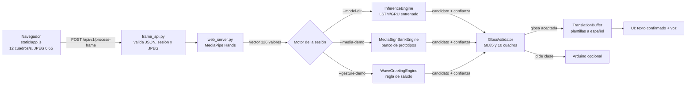
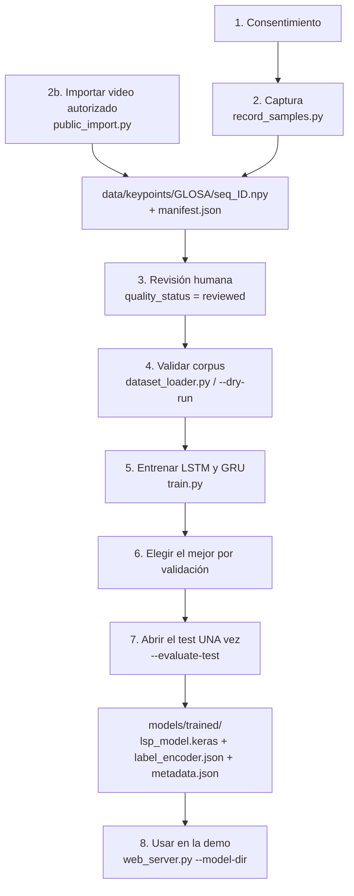

# Guía de funcionamiento y entrenamiento del intérprete LSP

Actualizado: 2026-11-03, sobre el commit `43c6958`. Esta guía explica:

- cómo funciona el proyecto de punta a punta;
- cómo se entrena el modelo y cómo se ajustan sus parámetros;
- cómo se carga el modelo entrenado para que la demo reconozca señas.

Cada valor citado sale del código (`archivo:línea`). Los comandos de la sección 13 se ejecutaron en el contenedor `interprete-lsp:dev`.

> **Estado real (léase primero).** El código de entrenamiento funciona de punta a punta: captura, validación, entrenamiento LSTM/GRU, evaluación, guardado, carga e inferencia. Sin embargo, **todavía no existe un modelo entrenado con señas reales**, porque falta el corpus: 30 muestras revisadas por clase, de al menos 5 personas. Lo que hoy reconoce algo en la demo son dos motores que **no se entrenan con una red**:
> - el banco de prototipos (números, abecedario y meses);
> - la regla geométrica del saludo «Hola».
>
> Ver sección 3.

---

## 1. Qué hace el sistema

Una persona hace señas frente a la cámara de su celular o laptop:

1. El navegador envía cuadros JPEG al servidor.
2. MediaPipe detecta las manos y produce 21 puntos por mano.
3. Un **motor de reconocimiento** propone una glosa (por ejemplo `HOLA`).
4. Un **validador** solo la acepta si es estable y confiable.
5. Un **traductor** convierte las glosas aceptadas en español («Yo quiero agua.»).
6. Ese texto se muestra en pantalla y, opcionalmente, se lee en voz alta o se envía a un Arduino.



## 2. Cómo se representa una seña (la entrada de todos los motores)

| Paso | Qué ocurre | Dónde |
|---|---|---|
| Detección | MediaPipe Hands entrega 21 puntos (x, y, z) por mano, hasta 2 manos | `web_server.py:49-107`, `src/vision/mediapipe_detector.py` |
| Vector por cuadro | 126 valores: 63 de la mano izquierda + 63 de la derecha. Si una mano no aparece, sus 63 valores son 0 | `mediapipe_detector.py:73-97` |
| Normalización | Por mano: se resta la muñeca (punto 0) y se divide por la distancia muñeca–nudillo medio (punto 9). Así no importa dónde está la mano ni lo cerca que esté de la cámara | `src/vision/normalization.py:17-77` |
| Ventana temporal | Se toma **1 segundo** de cuadros. Si entre dos cuadros hay más de 200 ms, la ventana se descarta | `src/vision/temporal.py:7-8` |
| Remuestreo | Ese segundo se interpola linealmente a **30 posiciones fijas**. Resultado: matriz **(30, 126)** float32 | `temporal.py:27-28` |

El formato está versionado: esquema `hands-126-v1`, normalización `wrist-palm-v1` y espejo `mediapipe-selfie-input` (`temporal.py:4-6`). El modelo guarda esas versiones y el servidor rechaza un modelo con otras. Por eso **cambiar la normalización obliga a volver a capturar y a entrenar**.

> La cámara del navegador envía unos 12 cuadros/s (`static/app.js:2`). El remuestreo a 30 posiciones hace que el modelo vea siempre la misma forma aunque la cadencia real varíe.

## 3. Los tres motores de reconocimiento

| Motor | Se activa con | Vocabulario | ¿Se entrena? | Estado |
|---|---|---|---|---|
| **A. Red neuronal LSTM/GRU** (`src/inference/engine.py`) | `--model-dir models/trained` | 9 clases base: REPOSO, HOLA, GRACIAS, POR_FAVOR, AYUDA, YO, QUERER, AGUA, BUENOS_DIAS (`config/actions.py:7-17`) | **Sí**: aprende pesos con `src/training/train.py` | Código probado; sin corpus real |
| **B. Banco de prototipos** (`src/inference/media_bank.py`) | `--media-demo [--media-category numbers\|alphabet\|months]` | Números 1–20, abecedario A–Z + Ñ, 12 meses | **No**: se «construye» extrayendo prototipos de videos e imágenes con `scripts/build_media_bank.py` | Funciona en demo; precisión no medida |
| **C. Regla de saludo** (`src/inference/wave.py`) | `--gesture-demo` | HOLA (mano abierta agitada) | **No**: parámetros fijos en `models/gestures/wave_hola.json` | Funciona en demo |

Los tres motores devuelven el mismo contrato (`prediction` con `class_id`, `gloss` y `confidence`), así que comparten el validador, el traductor y la interfaz (`src/inference/pipeline.py`). El servidor solo admite uno a la vez (`web_server.py:295-296`).

---

## 4. Preparar el entorno

**Opción recomendada (Linux / contenedor).** En Windows, la política de control de aplicaciones bloquea `optree` y `_ssl`, y Keras no carga (ver `docs/execution/ENV-03.md`). En Linux sí funciona.

```bash
python3.11 -m venv venv_lsp
venv_lsp/bin/python -m pip install --require-hashes -r requirements-linux.lock
```

Contenedor ya construido en esta máquina: imagen `interprete-lsp:dev` (Python 3.11, dependencias de `requirements.txt` y `espeak-ng` para la voz):

```bash
docker run --rm -it -v "$PWD":/app -w /app -p 5000:5000 interprete-lsp:dev bash
```

Versiones fijadas: TensorFlow 2.16.1, MediaPipe 0.10.14, OpenCV contrib 4.11.0.86, NumPy 1.26.4 y Flask 3.1.3 (`requirements.txt`).

---

## 5. Entrenar el modelo LSTM/GRU paso a paso



### 5.1 Capturar muestras con la cámara

```bash
python -m src.dataset.record_samples --gloss HOLA --participant participante-01 \
       --consent-ref CONS-2026-001 --samples 30 [--session S1] [--camera 0]
```

- `--gloss` solo acepta las 9 clases de `ACTIONS`. `--participant` es un seudónimo, nunca un nombre real. `--samples` va de 1 a 100.
- Cada muestra: cuenta regresiva de 2 s, captura de 1 s, normalización y guardado (`record_samples.py:98-123`). `q` o `Esc` cancela y no guarda nada parcial.
- Se guarda `data/keypoints/HOLA/seq_<uuid>.npy` (30×126) y se agrega una entrada a `data/keypoints/manifest.json`. La entrada lleva participante, sesión, consentimiento, versiones, timestamps, hueco máximo, checksum SHA-256 y **`quality_status: "unreviewed"`** (`record_samples.py:80-86`).
- La escritura es atómica y un candado (`.capture.lock`) impide dos capturas a la vez.

**Qué grabar.** Al menos **30 muestras válidas por clase** y **5 o más participantes**; el plan apunta a 30–50 por clase. Varíen iluminación, distancia, sesión y mano dominante. **REPOSO** también se graba: manos abajo o en posición de descanso.

### 5.2 Corpus PeruSIL: entrenar con señas reales ya (recomendado mientras no haya corpus propio)

`src/dataset/perusil.py` convierte el corpus PeruSIL (PUCP-DGI156, CC0, 17 participantes) al formato del proyecto. Todo el proceso corre con un solo script:

```bash
docker compose build
docker compose run --rm lsp bash scripts/entrenar_perusil.sh
```

| Fase | Comando | Qué hace |
|---|---|---|
| 1 | `python -m src.dataset.perusil descargar --que anotaciones` | Baja SRT.tar y la tabla de participantes (~200 KB), verificando tamaño y MD5 |
| 2 | `python -m src.dataset.perusil plan [--min-participants 10] [--excluir GLOSA]` | Elige las glosas con ≥30 clips, ≥10 personas y presencia en train/validation/test; escribe `config/vocabularies/perusil.json` |
| 3 | `python -m src.dataset.perusil descargar --que videos` y luego `extraer` | Baja Videos.tar (~1.08 GB, reanudable) y saca solo los 27 videos originales |
| 4 | `python -m src.dataset.perusil importar --root data/keypoints_perusil --aceptar-anotacion-fuente` | Ventana de 1 s centrada en cada seña, espejada y normalizada; guarda con procedencia; reanuda si se corta |
| 5 | `python -m src.training.train --root data/keypoints_perusil --vocabulary config/vocabularies/perusil.json --dry-run` | Valida el corpus |
| 6 | Igual que la fase 5, con `--output models/perusil --evaluate-test` | Entrena LSTM/GRU y abre el test una vez |

Vocabulario actual: 12 glosas (PENSAR, MUJER, HOMBRE, YO, CAMINAR, TU, NO, DOS, QUE?, YA, CASA y SI). El modelo guarda su vocabulario y la demo lo usa al cargarlo (`--model-dir models/perusil`). Como PeruSIL no tiene REPOSO, cada glosa aceptada se muestra al momento y como lectura literal («Mujer pensar.»). Decisiones y límites en [DAT-05](execution/DAT-05.md).

Los hiperparámetros ahora se pasan por línea de comandos sin editar código: `--units`, `--dense-units`, `--dropout`, `--l2`, `--learning-rate`, `--batch-size` y `--patience` (valores por defecto: 64, 32, 0.3, 1e-4, 1e-3, 16 y 10). Cada experimento debe ir a un directorio nuevo (`--output models/exp-02`).

### 5.2b Importar video de un corpus con licencia (opcional)

```bash
python -m src.dataset.public_import --index indice.json --videos-root data/raw_videos/perusil
```

El índice debe declarar `"license": "CC0-1.0"`, `permission_ref`, `source` y una lista `clips` con `video`, `start_ms`, `end_ms` (al menos 1 s), `gloss`, `participant_id` y `session_id` (`public_import.py:48-73`). Cada intervalo produce una sola muestra. PeruSIL (PUCP, CC0) es la fuente prioritaria, pero hoy no cubre las 9 clases (`docs/data/OPEN-SOURCES.md`).

### 5.3 Revisión humana

Una persona usuaria de LSP o un asesor revisa cada muestra. Las aprobadas se marcan editando el manifiesto: `"quality_status": "reviewed"`. Sin esa marca, el entrenamiento las excluye. `--allow-unreviewed` existe solo para explorar y deja el modelo marcado como `exploratory`.

### 5.4 Validar el corpus antes de entrenar

```bash
python -m src.dataset.dataset_loader --root data/keypoints
python -m src.training.train --dry-run [--allow-unreviewed]
```

El cargador (`dataset_loader.py:25-78`) excluye una muestra si:

- la ruta sale de la raíz;
- la glosa no coincide con la carpeta;
- el esquema no coincide;
- falta procedencia;
- no está revisada;
- el checksum no cuadra;
- la matriz no es (30, 126) float32;
- la ventana no dura exactamente 1000 ms o tiene huecos de más de 200 ms.

El `--dry-run` imprime muestras, conteo por clase, tamaño de cada partición y si se cumple el mínimo de 30 por clase, **sin entrenar**.

**Particiones por persona** (`dataset_loader.py:81-95`). Las personas se barajan con semilla 42 y se reparten 60 % entrenamiento, 20 % validación y 20 % test. Todas las muestras de una persona quedan en una sola partición; así no hay fuga y la nota del test mide a personas que el modelo nunca vio. Se exigen **al menos 5 participantes** y **las 9 clases en cada partición**; si falta alguna, el proceso se detiene con «recopilar más datos».

### 5.5 Entrenar

```bash
python -m src.training.train --root data/keypoints --output models/trained --epochs 100
```

`run_training` (`train.py:56-104`) hace lo siguiente:

1. Comprueba que cada clase tenga al menos 30 muestras y que las épocas estén entre 1 y 100.
2. Entrena **dos** modelos con la misma semilla (42): uno LSTM y otro GRU.
3. Usa `EarlyStopping`: se detiene si la pérdida de validación no mejora en 10 épocas y restaura los mejores pesos.
4. **Elige el de menor pérdida de validación**; el test no se usa para elegir.
5. Guarda `models/trained/lsp_model.keras`, lo vuelve a cargar y comprueba que predice lo mismo (tolerancia 1e-5).
6. Escribe `label_encoder.json` (orden de clases) y `metadata.json`. El metadata incluye versiones de esquema y librerías, commit, semilla, hash del manifiesto, hash del modelo, curvas de entrenamiento de ambos modelos y `release_approved: false`.

### 5.6 Evaluar con el test reservado (una sola vez)

```bash
python -m src.training.train --evaluate-test
```

Calcula sobre el 20 % de personas reservadas:

- accuracy y macro-F1;
- precisión, recall y F1 por clase;
- soporte y matriz de confusión;
- un baseline mayoritario (predecir siempre la clase más común) para comparar.

Crea `models/trained/test-opened.json` y **no deja volver a abrir el test en ese directorio** (`train.py:63-65`). Si el resultado es malo, no se reentrena mirando el test: se recogen más datos y se crea un corpus nuevo con su propio test.

**Metas del plan** (`docs/ml/TRAINING-PLAN.md`):

- macro-F1 ≥ 0.85;
- recall por clase ≥ 0.70;
- como mucho 1 falsa emisión por minuto en 5 minutos de reposo o de gestos fuera del vocabulario.

### 5.7 Usar el modelo entrenado en la demo

```bash
python web_server.py --host 127.0.0.1 --port 5000 --model-dir models/trained
```

`load_predictor` (`engine.py:11-34`) **rechaza** el modelo si:

- el esquema, la normalización o el espejo difieren;
- el orden de clases del metadata no coincide con el de `label_encoder.json` (el modelo puede tener su propio vocabulario: las 9 glosas base o el de PeruSIL);
- el SHA-256 de `lsp_model.keras` no coincide con el del metadata (un archivo alterado no se carga);
- la forma de entrada no es (30, 126) o la de salida no es 9.

En tiempo real, `InferenceEngine` (`engine.py:37-74`):

1. Normaliza cada cuadro y guarda el último segundo de cuadros.
2. Si hay un hueco de más de 200 ms, vacía ese buffer.
3. Remuestrea a 30 posiciones y predice.
4. Devuelve la clase ganadora como **candidata**. Si hay empate, no propone nada.

---

## 6. Parámetros que se pueden ajustar

### 6.1 Red neuronal y entrenamiento

| Parámetro | Valor actual | Dónde | Efecto / cuándo ajustarlo |
|---|---|---|---|
| Tipo de capa recurrente | LSTM y GRU (se entrenan las dos) | `train.py:73`, `model_builder.py:26` | GRU es más liviana; LSTM retiene mejor dependencias largas. Se elige por validación |
| Unidades recurrentes | 64 | `model_builder.py:29` | Subir (96–128) si el modelo no aprende (*underfitting*); bajar (32) si memoriza con pocos datos |
| Regularización L2 | 1e-4 | `model_builder.py:29` | Subir (1e-3) si la pérdida de entrenamiento baja pero la de validación sube (*overfitting*) |
| Dropout | 0.3 | `model_builder.py:8,19` (rango válido 0–<1) | Subir a 0.4–0.5 contra *overfitting*; bajar a 0.2 si no aprende |
| Capa densa | 32 ReLU | `model_builder.py:31` | Rara vez se toca; aumentar solo con más clases o más datos |
| Optimizador / tasa de aprendizaje | Adam 1e-3 | `model_builder.py:34` | Si la pérdida oscila, bajar a 5e-4 o 1e-4; si avanza muy lento, probar 2e-3 |
| Función de pérdida | sparse categorical crossentropy | `model_builder.py:35` | Etiquetas enteras; no cambiar a *one-hot* |
| Épocas máximas | 100 (límite 1–100) | `train.py:59,111` (`--epochs`) | EarlyStopping suele cortar antes |
| Tamaño de lote | 16 | `train.py:78` | Bajar a 8 con corpus muy pequeños; subir a 32 con muchos datos |
| Paciencia de EarlyStopping | 10 épocas sobre `val_loss` | `train.py:79` | Subir (15–20) si la validación es ruidosa |
| Semilla | 42 | `train.py:74`, `dataset_loader.py:81` | Fijarla permite repetir resultados; cambiarla da otra partición |
| Mínimo por clase | 30 muestras | `train.py:57` | Es una puerta de calidad: no bajarla para «poder entrenar» |
| Reparto de personas | 60/20/20, mínimo 5 participantes | `dataset_loader.py:83-88` | Con más personas, el reparto es más estable |

> La validación de la configuración exige forma (30, 126), exactamente 9 clases y solo LSTM o GRU (`model_builder.py:8-16`). Cambiar algo de eso exige tocar ese archivo (ver sección 9).

### 6.2 Visión y ventana temporal

| Parámetro | Valor | Dónde | Efecto |
|---|---|---|---|
| Confianza de detección / seguimiento de MediaPipe | 0.5 / 0.5 | `config/settings.py:11-12` (los usan el detector y el servidor) | Subir reduce falsas manos; bajar ayuda con poca luz. El banco de medios usa 0.3–0.35 al extraer |
| Duración de la ventana | 1000 ms | `src/vision/temporal.py:7` | Señas largas pueden necesitar más. **Cambia el esquema**: recapturar y reentrenar |
| Hueco máximo | 200 ms | `temporal.py:8`, `engine.py:52` | Más alto tolera redes lentas, pero mezcla movimientos |
| Posiciones por ventana | 30 | `temporal.py:27` y forma (30, 126) en todo el código | Fijo por esquema |
| Cuadros/s del navegador | 12 | `static/app.js:2` | Más cuadros dan ventanas más completas, pero más carga en el servidor |
| Calidad JPEG / ancho máximo | 0.65 / 640 px | `static/app.js:3-4` | Más calidad mejora la detección y aumenta la latencia |

### 6.3 Validación de glosas (cuándo una candidata se acepta)

| Regla | Valor | Dónde |
|---|---|---|
| Confianza mínima | 0.85 | `src/logic/validator.py:11` y `src/logic/lsp_rules.pl:7` |
| Cuadros estables consecutivos | 10 | `validator.py:12,68` y `lsp_rules.pl:7` |
| REPOSO confirmado (separa repeticiones) | 10 cuadros y ≥500 ms | `validator.py:63` |
| Hueco que reinicia la estabilidad | >200 ms | `validator.py:48` |
| Frase: máximo de glosas / tiempo | 20 glosas / 10 s | `src/nlp/translator.py:96,103` |

> **Importante:** `config/settings.py` declara `PREDICTION_THRESHOLD = 0.85`, `STABILITY_FRAMES = 10`, `SEQUENCE_LENGTH = 30` y `TARGET_FPS = 30`, pero **ningún módulo los usa**. Los valores efectivos son los de las tablas: están escritos en `validator.py`, `lsp_rules.pl`, `temporal.py` y `app.js`. Para cambiar el umbral hay que editar **`validator.py` y `lsp_rules.pl` juntos**; `tests/test_logic.py` comprueba que coinciden. El umbral se calibra con la partición de **validación**, nunca con el test: con un modelo real, revisar si 0.85 deja pasar falsas emisiones o rechaza demasiado.

### 6.4 Banco de prototipos (motor B)

| Parámetro | Valor | Dónde | Efecto |
|---|---|---|---|
| Similitud mínima | 0.85 | `media_bank.py:232` | Subir reduce confusiones y deja más señas sin reconocer |
| Ventana / hueco | 1000 ms / 350 ms | `media_bank.py:252-253` | — |
| Pesos para señas estáticas | 0.6 postura media + 0.2 inicio + 0.2 fin; penalización por movimiento si el cambio supera 0.35; 0.20 si hay dos manos | `media_bank.py:193-198` | Afinar si un número estático se confunde al mover la mano |
| Pesos para señas con transición (11–20, J, K, Ñ, Q, X, Z) | 0.4/0.3/0.3; +0.04 si hay movimiento y −0.10 si no | `media_bank.py:199-205` | — |
| Pesos para meses abreviados con giro | 0.7/0.15/0.15; +0.06 / −0.14 | `media_bank.py:206-211` | — |
| Pesos para señas con dos manos | 0.65 mano principal + 0.35 segunda mano | `media_bank.py:213-220` | — |
| Rasgos de postura | 63 coordenadas + extensión de dedos (×0.6) + distancias al pulgar (×0.8) + altura de puntas (×0.6) = 81 valores | `media_bank.py:57-62` | Los pesos dan más importancia a la forma de los dedos |

### 6.5 Regla de saludo (motor C)

En `models/gestures/wave_hola.json`:

| Parámetro | Valor | Qué controla |
|---|---|---|
| `window_ms` | 2200 | Ventana de observación |
| `min_duration_ms` | 450 | Duración mínima del movimiento |
| `min_swing` | 0.045 | Tamaño mínimo de cada vaivén |
| `min_range` | 0.12 | Recorrido horizontal mínimo |
| `max_vertical_range` | 0.22 | Movimiento vertical máximo permitido |
| `reversals` | 2 | Cambios de dirección exigidos |
| `hold_ms` | 1600 | Tiempo que se mantiene el «Hola» detectado |
| `rearm_ms` | 900 | Tiempo sin mano para poder repetir |

Si el saludo cuesta, bajar `min_range` o `reversals`; si se dispara solo, subirlos.

---

## 7. Cómo se ajustan los parámetros (método)

1. **Datos primero.** Con pocos datos, ningún ajuste compensa. Revisar el `--dry-run` y la matriz de confusión antes de tocar la red.
2. **Leer las curvas** de `metadata.json["histories"]` (`loss`, `val_loss`, `accuracy`, `val_accuracy` por época):
   - las dos pérdidas altas indican *underfitting*: más unidades, menos dropout o más tasa de aprendizaje;
   - una pérdida de entrenamiento baja y una de validación que sube indican *overfitting*: más dropout o L2, menos unidades y, sobre todo, más datos;
   - una validación que salta de época en época pide bajar la tasa de aprendizaje o subir la paciencia.
3. **Cambiar un parámetro por vez**, reentrenar en un **directorio nuevo** (`--output models/exp-02`) y comparar el `val_loss` mínimo de cada experimento. Anotar el cambio y el resultado.
4. **Elegir solo con validación.** El test se abre una vez, al final, con la configuración elegida (`--evaluate-test`).
5. **Calibrar el umbral 0.85 y los 10 cuadros** con validación y con grabaciones de reposo o gestos fuera del vocabulario, contando falsas emisiones por minuto.
6. Comparar siempre contra el **baseline mayoritario** que reporta el metadata: si el modelo no lo supera claramente, no sirve.

> Desde el 2026-11-03 los hiperparámetros se pasan por línea de comandos (`--units`, `--dense-units`, `--dropout`, `--l2`, `--learning-rate`, `--batch-size`, `--patience`) y quedan registrados en `metadata.json["hyperparameters"]`, junto con las métricas de validación.

---

## 8. Construir o ampliar el banco de prototipos (motor B)

```bash
python -m scripts.build_media_bank --media-dir <carpeta_de_medios> --step numbers|alphabet|months|all
```

- Lee los videos e imágenes de referencia, cuyos nombres están fijos en el script (`build_media_bank.py:166-167, 227-228, 306`). Recorta cada seña con intervalos en milisegundos (`NUMBER_INTERVALS`, `ALPHABET_INTERVALS` y `MONTH_INTERVALS`, líneas 26-92) y usa el núcleo central del clip (15 %–85 %) para no incluir las transiciones.
- Para cada intervalo calcula un descriptor:
  - postura media, de inicio y de fin;
  - postura de la segunda mano;
  - cambio postural, temblor y rango de la muñeca;
  - giros y proporción de cuadros con dos manos.

  Lo guarda como prototipo en `models/gestures/<categoría>_bank.json`, junto con el tipo de movimiento: `static`, `dynamic_transition`, `dynamic_bimanual` o `rotated_initial`.
- También guarda secuencias (30, 126) en `data/keypoints_media/`. Hoy hay 59 carpetas, pero **sin `manifest.json`**, así que **no sirven todavía para entrenar la red**.
- En la demo, cada ventana se compara con todos los prototipos y gana el más parecido si supera 0.85. La confianza mostrada se reescala a 0.85–0.99 (`media_bank.py:310`) para que pase el validador. **No es una probabilidad.**

**Agregar una seña al banco:**

1. Grabar un video de referencia.
2. Añadir su intervalo `(glosa, inicio_ms, fin_ms, tipo_de_movimiento)` a la lista de la categoría.
3. Volver a correr el script.
4. Añadir la glosa a `config/actions.py` (`EXTENDED_ACTIONS`) y su plantilla en `src/nlp/translator.py`.
5. Actualizar `class_count/1` en `src/logic/lsp_rules.pl`, que debe valer `len(EXTENDED_ACTIONS)`; hoy es 68.

> Los medios originales (`C:\proyectos\media`) no están en el repositorio y su licencia no está documentada (MEDIA-DEBT-01). Antes de publicar bancos o keypoints derivados, hay que registrar el origen y el permiso.

---

## 9. Ampliar el vocabulario de la red neuronal

Desde el 2026-11-03 el vocabulario es configurable: no hace falta tocar `config/actions.py`.

1. Crear un JSON con las clases en orden, por ejemplo `config/vocabularies/mi_corpus.json` con `{"classes": ["REPOSO", "HOLA", "UNO", ...]}`. Las glosas van en MAYÚSCULAS y pueden llevar dígitos, `_` o `?`. Si hay una clase de reposo, debe llamarse `REPOSO` e ir primera: así el validador la usa para cerrar frases.
2. Capturar o importar muestras con esas glosas (`save_sample(..., allowed_glosses=clases)`). En el caso de PeruSIL, el importador lo hace solo.
3. Entrenar con `--vocabulary config/vocabularies/mi_corpus.json`. El modelo guarda el orden de clases en `label_encoder.json` y `metadata.json`, y la demo lo toma de ahí al cargarlo.
4. Opcional: plantillas de español en `src/nlp/translator.py`. Sin plantilla, las glosas se muestran como lectura literal.
5. Correr la suite completa: `python -m unittest discover -s tests -v`.

---

## 10. Traducción a español

Las glosas aceptadas se acumulan en `TranslationBuffer`. Se traducen cuando:

- hay un REPOSO confirmado;
- pasan 10 s;
- se llega a 20 glosas;
- o la glosa es inmediata, como en los motores B y C.

`translate_glosses` (`translator.py:73-85`) aplica estas reglas:

- **Plantillas fijas:** `[YO, QUERER, AGUA]` → «Yo quiero agua.», `[HOLA]` → «Hola.».
- **Deletreo:** dos o más letras forman palabra (`[C, A, S, A]` → «Casa.»).
- **Fecha:** número + mes da «20 de octubre.».
- **Lista de números:** varios números dan «Uno, cinco.».
- **Sin plantilla:** se muestran las glosas con «Sin plantilla disponible»; nunca se inventa una frase.

Todo sale con `linguistic_review: "pending"`, porque las plantillas son exploratorias hasta que las revise un asesor de LSP.

---

## 11. Arrancar la demo

```bash
# Solo detección de manos (sin reconocimiento)
python web_server.py --host 127.0.0.1 --port 5000

# Saludo «Hola» por regla
python web_server.py --gesture-demo

# Números, abecedario y meses por prototipos
python web_server.py --media-demo --media-category all

# Modelo entrenado
python web_server.py --model-dir models/trained

# Arduino opcional en cualquiera de los modos
python web_server.py --model-dir models/trained --serial-port /dev/ttyUSB0
```

Abrir `http://127.0.0.1:5000` y autorizar la cámara.

- Si existe `LSP_ACCESS_KEY` (al menos 32 caracteres), la demo pide clave.
- Para entrar desde otro equipo hay que fijar `LSP_ALLOWED_ORIGINS` con la URL exacta.
- La API es: `POST /api/v1/sessions`, luego `POST /api/v1/process-frame` con `session_id`, `frame_id`, `captured_at_ms` y el JPEG en data URL (contrato en `docs/backend/API-CONTRACTS.md`).

---

## 12. Pruebas

```bash
python -m unittest discover -s tests -v                       # suite completa
LSP_NATIVE_ML_TESTS=1 python -m unittest tests.test_training_end_to_end -v   # entrena de verdad (TensorFlow)
```

`test_training_end_to_end.py` crea un corpus sintético separable: 10 personas × 9 clases × 3 muestras. Entrena LSTM y GRU, abre el test una vez, carga el modelo, reconoce una ventana y comprueba que un artefacto alterado se rechaza. **Valida el software, no la precisión con señas reales.**

## 13. Ejecución verificada (2026-11-03)

Corrida en el contenedor `interprete-lsp:dev`, con el mismo corpus sintético de la prueba anterior, escrito con `save_sample` en `data/keypoints`:

| Paso | Resultado |
|---|---|
| `--dry-run` | 270 muestras; particiones de 162 / 54 / 54 (6/2/2 personas); mínimo de 30 por clase cumplido |
| LSTM | 40 épocas; `val_loss` mínimo 0.003; precisión de validación 1.0 |
| GRU | 40 épocas; `val_loss` mínimo 0.006; precisión de validación 1.0 |
| Selección | LSTM (menor `val_loss`) |
| Test reservado | accuracy 1.0 y macro-F1 1.0, contra 0.022 del baseline mayoritario |
| Tiempo total | 15.8 s en CPU |
| Artefactos | `lsp_model.keras` (632 KB), `label_encoder.json`, `metadata.json` (`release_approved: false`, `exploratory: true`) y `test-opened.json` |

El 100 % se explica porque cada clase sintética es una postura distinta y separable. **Con señas reales se esperan valores mucho menores**; las metas son macro-F1 ≥ 0.85 y recall ≥ 0.70 por clase.

## 14. Límites y pendientes conocidos

- **No hay corpus real** (DAT-03): por eso no hay modelo de señas entrenado ni precisión medida.
- Las 59 secuencias de `data/keypoints_media/` no tienen manifiesto ni procedencia: no entran al entrenamiento.
- La demo trae las 9 clases de la red y las 59 glosas del banco de prototipos (números, abecedario y meses), es decir 68 en total. La red solo cubre las 9.
- El vector usa solo las manos: no ve la cara, el cuerpo ni dónde está la mano respecto al cuerpo (VIS-DEBT-01). Señas que dependen de eso se confunden.
- El validador del pipeline usa la versión en Python; `lsp_rules.pl` (Prolog) se usa en las pruebas de paridad, no en cada cuadro.
- En Windows, Keras no carga por la política de control de aplicaciones: hay que entrenar en Linux o en el contenedor.
- Seguridad: queda abierta una vulnerabilidad alta de `protobuf`; el proyecto sigue **NO APTO para publicación** (`docs/quality/ISO-25010-AUDIT-REPORT.md`).
